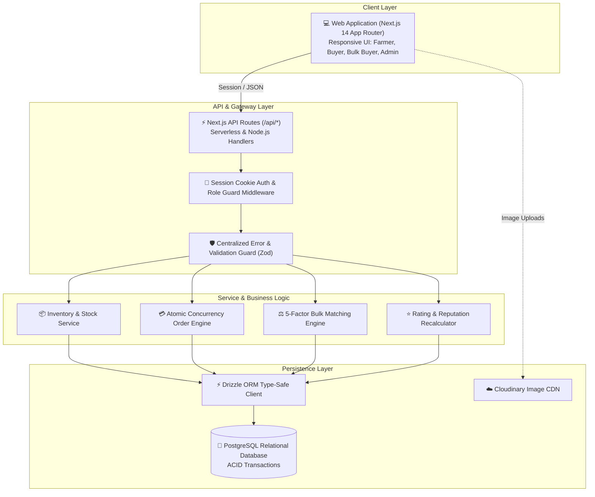
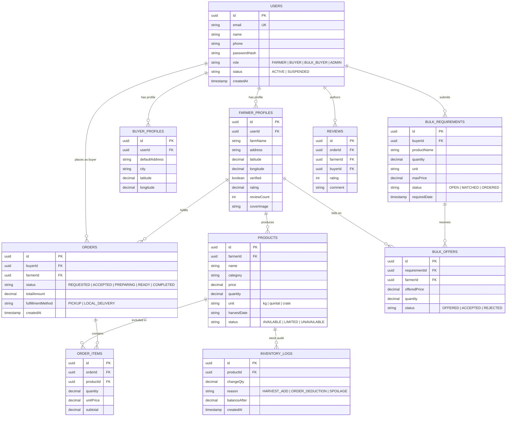
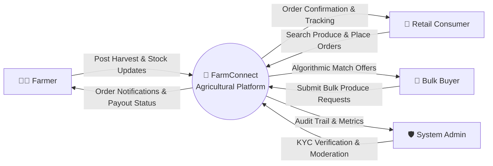
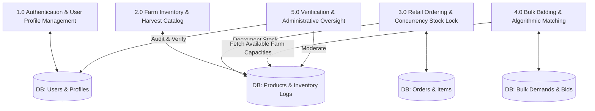
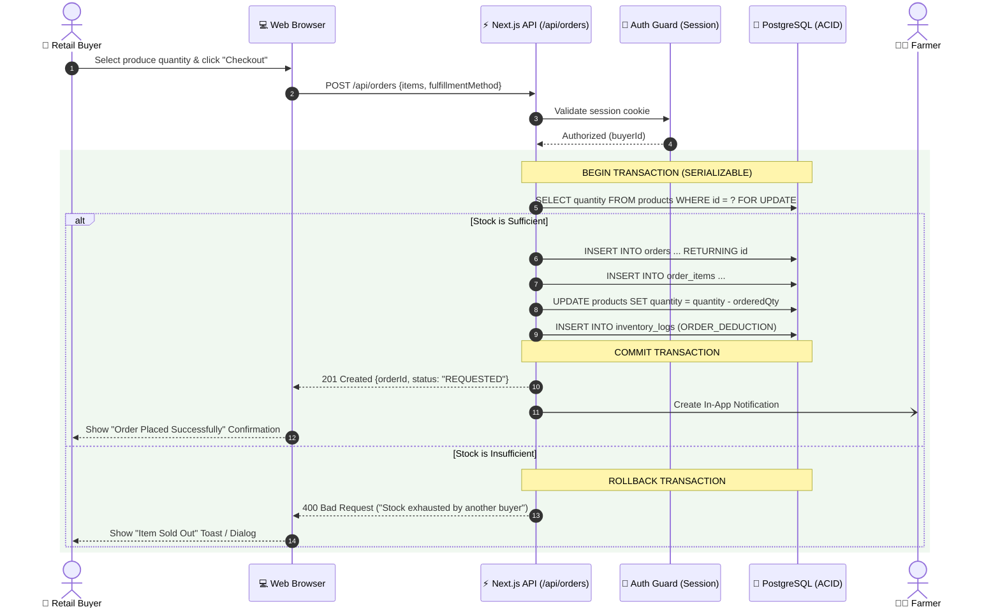

# System Architecture & Technical Design Document
## Project: FarmConnect — Direct Farmer-to-Buyer Marketplace
**Document Identifier:** FC-ARCH-2026-V1.0  
**Target Domain:** Direct Agricultural Supply Chain Platform  
**Target Evaluators:** Academic Community Project Review Committee  

---

## 1. High-Level System Architecture

FarmConnect utilizes a clean three-tier distributed architecture separating presentation, business logic, and transactional persistence.

---

## 2. Entity-Relationship Diagram (ERD)

The database schema is normalized to 3NF with foreign key constraints, cascade rules, and dedicated audit/inventory transaction tracking.

---

## 3. Data Flow Diagrams (DFD)

### 3.1 DFD Level 0 — Context Diagram
The Level 0 context diagram demonstrates how external stakeholders interact with the FarmConnect boundary.

---

### 3.2 DFD Level 1 — System Functional Decomposition

---

### 3.3 DFD Level 2 — Order Placement & Concurrency Transaction Flow

---

## 4. Security & Network Topology

1. **Authentication Token Flow**:
   - Web application uses HTTP-only encrypted session cookies (`farmconnect_session`) with `SameSite=Lax` for browser XSS and CSRF protection.
   - Server-side Next.js middleware enforces role authentication before rendering protected routes.
2. **Zero-Trust Input Sanitization**:
   - Every incoming request payload passes through Zod schema validation guards prior to hitting database operations.
3. **Role-Based Access Control (RBAC)**:
   - Access to `/api/admin/*` and `/admin/*` is strictly guarded by `requireRole("ADMIN")`.
   - Access to `/farmer/*` enforces farm ownership (`userId === product.farmerId`).

---
*End of System Architecture Document*
